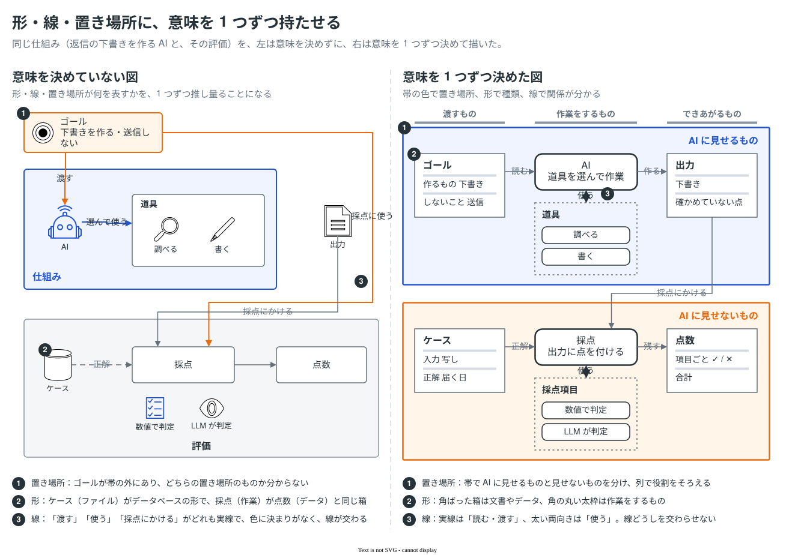

# 置き場所を帯で分け、同じ形には同じ意味を 1 つだけ持たせる

図の中のものを、どこに置くものか（置き場所）と、どんな種類のものか（種類）で分け、読み手がそれを図の上で見分けられるようにする。置き場所は帯で、種類は形で、関係は線で表し、どれにも意味を 1 つずつだけ持たせる。形・線・置き場所の意味が揃っていれば、読み手は 1 度決まりを覚えるだけで図全体を読める。揃っていないと、要素ごとに「この形は何を表すのか」を推し量ることになる。

## 帯で置き場所を分ける

- 置き場所や段階が分かれる図（AI に見せるものと見せないもの、手元とサーバーと外部サービスなど）は、それぞれを塗りのある帯で囲み、境界をはっきりさせる。同じ枠の中にあるものは、1 つのまとまりとして見える。
- 帯の名前は、どの帯でも同じ位置に置く。サンプルでは右上に揃えている。
- 帯をまたいで同じ役割を持つものは、同じ列に並べる。列の見出しを帯の上に書くと、帯（どこに置くか）と列（何をするか）の 2 つで、要素の位置に意味ができる。
- 一部の要素だけを帯の外に出さない。外に出た要素は、どの置き場所に属するのか分からなくなる。

## 形・線・置き場所に意味を 1 つずつ持たせる

- 1 枚の図の中で、同じ形はいつも同じ種類のものを表す。逆に、同じ種類のものは同じ形で描く。たとえば、角ばった箱は文書やデータ、角の丸い太枠は作業をするもの、点線の枠は同じ種類の集まり、と決めたら、ほかの意味では使わない。
- 兄弟（同じ種類で並ぶもの）は形・大きさ・文字の体裁を揃える。親子（入れ子）は、どの親も同じ囲み方にする。
- 線の種類も同じ。実線は「読む・渡す」、太い両向きは「使う」、破線は「人が書く」のように、1 種類に 1 つの意味を持たせる。線どうしは交わらせない。
- 色も 1 色に 1 つの意味にする（[drawio-style.md](../../references/drawio-style.md) の配色）。
- 決めた形と線の意味は、図の下に「図の読み方」としてまとめる。要素ごとの名前や線の意味は、[直接ラベル](../direct-labels/README.md)で対象の横に書く。

## アイコンは、形を見て意味が分かるときだけ使う

- AWS のサービスアイコンや、UML・BPMN の記号のように、読み手が形から意味を取れるアセットは使ってよい。
- 仕組みの全体の形のような抽象的な図に、ロボット・虫眼鏡・鉛筆のようなアイコンを足しても、文字で書いたこと以上は伝わらない。形の種類が増えるぶん、読み手が「この形は何を表すのか」を考える手間が増える。基本図形と文字で描く。
- アイコンを使うときも、名前は文字で添える。

## サンプル

同じ仕組み（返信の下書きを作る AI と、その評価）を、左は決まりを持たずに、右は決まりに沿って描いた。左右で同じ番号が同じ観点を指す。左では、ゴールが帯の外にあり（1）、ファイルがデータベースの形で描かれ、作業とデータが同じ箱になっている（2）。アイコンは見た目を足すだけで（3）、線の種類と色にも決まりがない（4）。右では、帯で置き場所を、形で種類を、線で関係を表し、それぞれに意味を 1 つだけ持たせている。

この決まりで仕組みの全体を描いた図は、[samples/concept-layers](../../samples/concept-layers/concept-layers.drawio.svg) にある。

## 根拠

- "the most similar elements (in color, size, and orientation for these examples) tend to be grouped together." / "Common region is the tendency for elements that lie within the same bounded area (or region) to be grouped together" — Wagemans et al. (2012). [A century of Gestalt psychology in visual perception: I. Perceptual grouping and figure–ground organization](https://doi.org/10.1037/a0029333), §3.1, §3.2.3
- "A new principle of grouping is proposed that is based on elements being located within a common region of space." / "capable of overcoming the effects of other powerful grouping factors such as proximity and similarity." — Palmer (1992). [Common region: A new principle of perceptual grouping](https://doi.org/10.1016/0010-0285(92)90014-S)（抄録）
- "Users should not have to wonder whether different words, situations, or actions mean the same thing." — Nielsen, J. [10 Usability Heuristics for User Interface Design](https://www.nngroup.com/articles/ten-usability-heuristics/), #4 Consistency and Standards
- "the extent to which a novice reader can infer the meaning of symbol from its appearance alone" — Caire, Genon, Heymans & Moody (2013). [Visual Notation Design 2.0: Towards User Comprehensible Requirements Engineering Notations](https://doi.org/10.1109/RE.2013.6636711), p. 2（Moody (2009) の Semantic Transparency の定義として）
- "most icons continue to be ambiguous to users due to their association with different meanings across various interfaces." / "a text label must be present alongside an icon to clarify its meaning in that particular context." — Harley, A. (2014). [Icon Usability](https://www.nngroup.com/articles/icon-usability/), Nielsen Norman Group
- "people's accuracy in describing the embellished charts was no worse than for plain charts, and that their recall after a two-to-three-week gap was significantly better." — Bateman et al. (2010). [Useful Junk? The Effects of Visual Embellishment on Comprehension and Memorability of Charts](https://doi.org/10.1145/1753326.1753716)（飾りが理解を妨げるとは限らないという結果。このプラクティスがアイコンを一律に禁じず、「形を見て意味が分かるときだけ使う」としているのはこのため）

## 既存のサンプルとの関係

[samples/](../../samples/README.md) の AWS 構成図などは、AWS のサービスアイコンを使っている。これらは読み手が形から意味を取れるアイコンなので、このプラクティスと食い違わない。
