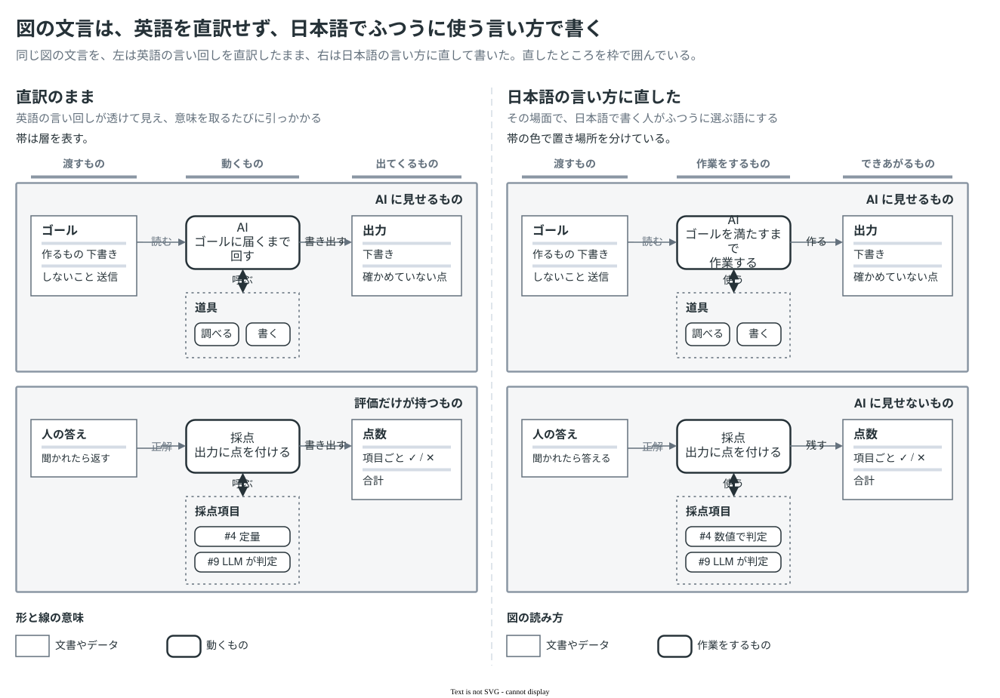

# 図の文言は直訳を避け、その言語でふつうに使う言い方で書く

図の文言は、図を載せる文書の言語で、その言語の書き手がその場面でふつうに選ぶ語で書く。英語で考えた言い回し（call、return、output など）を 1 語ずつ訳すと、意味は通じても読み手が引っかかり、図を読む速さが落ちる。図の中の文字は短く、前後の文脈も少ないので、文章の中より直訳が目立つ。

## 直し方

- 語を 1 つずつ訳さず、図のその場所で読み手に伝えたいことを、その言語で言い直す。たとえば評価の帯の名前は、「評価だけが持つもの」のように持ち主を書くより、読み手が知りたい「AI に見せないもの」を書く。
- 動詞は、その場面で使う語にする。「呼ぶ」「返す」「書き出す」はプログラムの用語なので、関数や API の話をしている箇所だけで使う。AI が道具を使う、質問に答える、点数を残す、のように、その場面の動作を表す語を選ぶ。
- 意味の広い漢語（定量、層）は、何をするのか、何で分けているのかが分かる言い方（数値で判定、帯の色で置き場所を分けている）に開く。
- 英語の名詞句をなぞった言い方（動くもの、出てくるもの、元にするもの）は、日本語で自然な形（作業をするもの、できあがるもの、元になるもの）にする。
- 書いたら声に出して読み、引っかかる語を探す。迷ったら、同じ分野の日本語の文書でその言い方が使われているかを確かめる。
- 英語や中国語の図でも同じ。日本語の図を訳すときも、語を置き換えるのではなく、その言語で自然な言い方にする。

コードの名前（`npm run eval`、`scorers/` など）や、読み手が英語のまま使っている用語は、無理に訳さない。

## 直した例

左は英語の言い回しを直訳したままの文言、右は直した文言。英語の列は、直訳のもとになったと考えられる言い回しの例。

| 直訳のまま | もとの英語の例 | 直した文言 | 直した理由 |
|---|---|---|---|
| 評価だけが持つ | owned only by evals | AI に見せない | 持ち主ではなく、読み手が知りたいこと（AI に見せるかどうか）を書く |
| 帯は層を表す | bands represent layers | 帯の色で置き場所を分けている | 何で何を分けているのかを、そのまま書く |
| 動くもの | things that run | 作業をするもの | 「動く」は物が動くように読める |
| 呼ぶ | call | 使う | 「呼ぶ」は関数を呼び出すときの用語 |
| 書き出す | write out | 作る／残す | 出力を作るなら「作る」、点数を記録するなら「残す」と、何をするかで選ぶ |
| 聞かれたら返す | return when asked | 聞かれたら答える | 質問には「答える」 |
| 出てくるもの | output | できあがるもの | 作業の結果として生まれることが分かる言い方にする |
| ゴールに届くまで | until it reaches the goal | ゴールを満たすまで | 日本語では、ゴールは「満たす」もの |
| 定量 | quantitative | 数値で判定 | 何をするのかを書く |
| 元にするもの | source | 元になるもの | 「元にする」は誰かが何かを使う言い方。置いてあるものを指すなら「元になる」 |
| 形と線の意味 | meaning of shapes and lines | 図の読み方 | 読み手がそれを使って何をするのかを書く |

## サンプル

同じ図の文言を、左は直訳のまま、右は日本語の言い方に直して並べた。図の形と線はどちらも同じで、変えたのは文言だけである。直したところを、左は橙、右は青の枠で囲んでいる。この図では色をこの区別に使うため、帯は灰色にしている。

## 根拠

- 「専門用語や外来語をむやみに用いないようにし、読み手に通じる言葉を選ぶ。」／「漢語や和語に置き換えた方が分かりやすいと判断される場合には、言い換えるとよい。」 — 文化審議会（2022）. [公用文作成の考え方（建議）](https://www.bunka.go.jp/seisaku/bunkashingikai/kokugo/hokoku/pdf/93651301_01.pdf), 2(2)エ、解説 Ⅱ-3 イ
- 「公共性の高い場で使われている分かりにくい『外来語』について，言葉遣いを工夫し提案することを目的として」 — 国立国語研究所「外来語」委員会. [「外来語」言い換え提案](https://www2.ninjal.ac.jp/gairaigo/)
- "Strict word-to-word translation would make the tone stiff and unnatural." / "should have the "look and feel" of a product originally written in Japanese, using idiomatic syntax and terminology" — Microsoft. [Japanese Localization Style Guide](https://aka.ms/japanese-styleguide), §2.1.4, §5
- "Use a simple word. For example, don't use words like commence when you mean start or begin." — Google. [Write for a global audience](https://developers.google.com/style/translation), Google developer documentation style guide
- "Read your text aloud. Avoid jargon and overly complex or technical language." — Microsoft. [Top 10 tips for Microsoft style and voice](https://learn.microsoft.com/en-us/style-guide/top-10-tips-style-voice), Microsoft Writing Style Guide

## 既存のサンプルとの関係

[samples/](../../samples/README.md) の英語版と中国語版（`docs/samples/en/`、`docs/samples/zh-CN/`）も、日本語版の語を置き換えるのではなく、その言語で自然な言い方に訳す。
