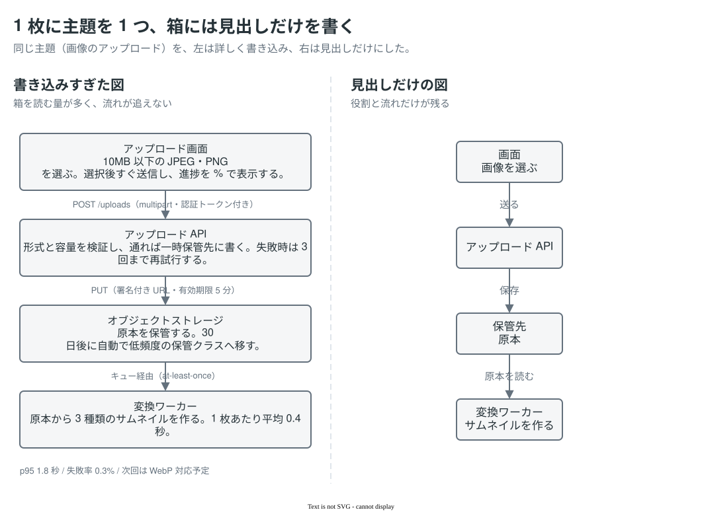

# 1 枚に主題を 1 つ、箱には見出しだけを書く

1 枚の図には、主題を 1 つだけ載せる。後続の作業、根拠、削ったもの、今後の予定は、本文に書く。

載せる要素は、描く前に決める。要素ごとに、役割・流れ・経路を読むのに要るかを問い、要らないものは外す。条件、間隔、ラベル名、実装の細部、理由、結果の数値は、たいてい外れる。

箱の文字は、見出し 1 行（日本語で 10〜15 字ほど）と、短い補足 1 行（20 字ほど）までにする。2〜4 行の説明は箱に書かない。文字を収めるために「呼出」「受取」のような窮屈な略語を使わない。本文の箇条書きを、そのまま図に移さない。

## サンプル

題材は、サンプルのために作った架空のもの。

画像のアップロードの流れを、左は書き込みすぎ、右は見出しだけにした。左は、箱に条件や数値を書き、線に通信の細部を書き、隅に数値と今後の予定まで載せたので、流れを追う前に読む量で疲れる。右は、役割と流れだけが残る。外した内容は、必要なら本文に書く。

## 根拠

- "Keep annotations concise. Limit them to around 50 characters (10 to 12 words) and a single sentence." — Office for National Statistics. [Annotations](https://service-manual.ons.gov.uk/data-visualisation/guidance/annotations)（グラフの注記の決まり。この skill の文字数の目安は、これを日本語の箱の字数に置き換えたもの）
- "interesting but irrelevant adjuncts" を足した文章を読んだ学生は、"recalled significantly fewer main ideas" and "generated significantly fewer problem-solving transfer solutions" — Harp & Mayer (1998). [How seductive details do their damage](https://doi.org/10.1037/0022-0663.90.3.414)（要旨。本筋と関係のない足しものは、理解を妨げる）
- "Most important, however, are differences in the efficiency of search for information and in the explicitness of information." — Larkin & Simon (1987). [Why a diagram is (sometimes) worth ten thousand words](https://doi.org/10.1111/j.1551-6708.1987.tb00863.x)（要旨。載せる要素が少ないほど、探す手間は小さい）
