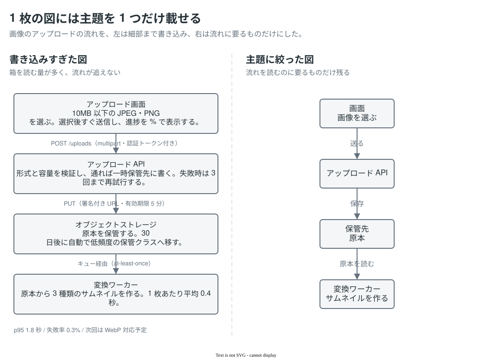

# 1 枚の図には主題を 1 つだけ載せる

1 枚の図には、主題を 1 つだけ載せる。載せる要素は描く前に決め、その主題を読むのに要らない補足は本文に書く。段落のような長い説明も、箱に詰めずに本文に書く。

何が要るかは主題で決まる。条件や数値が主題なら、それを図に載せる。

## サンプル

題材は、サンプルのために作った架空のもの。

画像のアップロードの流れを主題にした図で、左は通信の細部、容量の上限、性能の数値、今後の予定まで書き込んだ。右は、流れを読むのに要るものだけを残した。外した内容は、要るなら本文に書く。

## 根拠

- "interesting but irrelevant adjuncts" を足した文章を読んだ学生は、"recalled significantly fewer main ideas" and "generated significantly fewer problem-solving transfer solutions" — Harp & Mayer (1998). [How seductive details do their damage](https://doi.org/10.1037/0022-0663.90.3.414)（要旨。本筋と関係のない足しものは、理解を妨げる）
