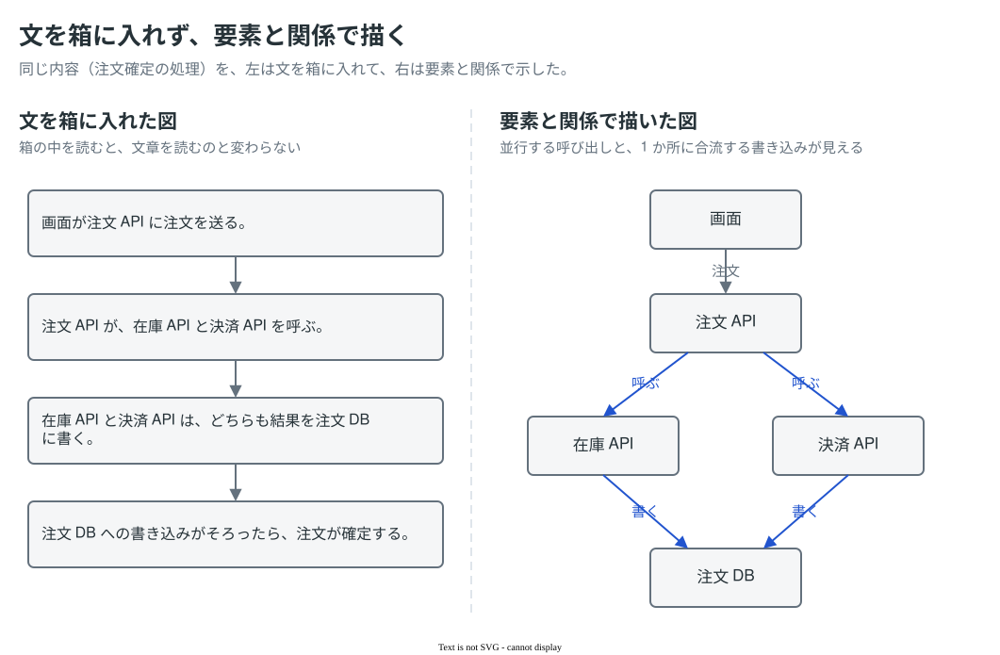

# 図にするのは、文章や箇条書きでは読み取りにくい関係だけ

図は、文章や箇条書きより速く読み取れる関係があるときだけ描く。描く前に、同じ内容を箇条書きか表にしても同じ速さで読めるかを考える。読めるなら、図にしない。

文を箱に入れただけの図や、文言を表・列・帯に並べただけの図は、説明を平面に置き直しただけで、文章より読みやすくならない。対象を要素（入れ子の箱など）と関係（含む、参照する、導く、呼ぶ、前後する）で捉え直して描く。

## 図にする価値があるもの

- 分岐して合流する依存や呼び出し
- 似た仕組みの形の比較
- 順序の制約と状態の遷移
- 複数の主体のあいだの役割や権限の境界
- 変更前後の構造

## 図にしないもの

- 分類や一覧
- 二択の選択肢 1 つ
- 一本道の手順
- 本文の要約を箱に詰めたもの
- 飾り

その図が、本文にない何を示すのかを言えないなら、文章だけにする。

## サンプル

題材は、サンプルのために作った架空のもの。

注文確定の処理を、左は文を箱に入れて、右は要素と関係で示した。左は、箇条書きを読むのと変わらない。右では、注文 API から 2 つの API への分岐と、注文 DB への合流が、形で分かる。

## 根拠

- "Diagrammatic representations also typically display information that is only implicit in sentential representations" / "problem solving can proceed through a smooth traversal of the diagram, and may require very little search" — Larkin, J. H. & Simon, H. A. (1987). [Why a diagram is (sometimes) worth ten thousand words](https://doi.org/10.1111/j.1551-6708.1987.tb00863.x)（要旨。同じ情報でも、図は位置で情報を整理するので探す手間が減る）
- "interesting but irrelevant adjuncts" を足すと、"recalled significantly fewer main ideas" — Harp & Mayer (1998). [How seductive details do their damage](https://doi.org/10.1037/0022-0663.90.3.414)（要旨。飾りや本筋と関係のない足しものは、理解を妨げる）
